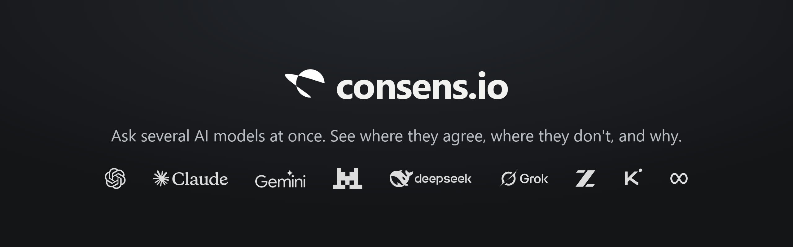
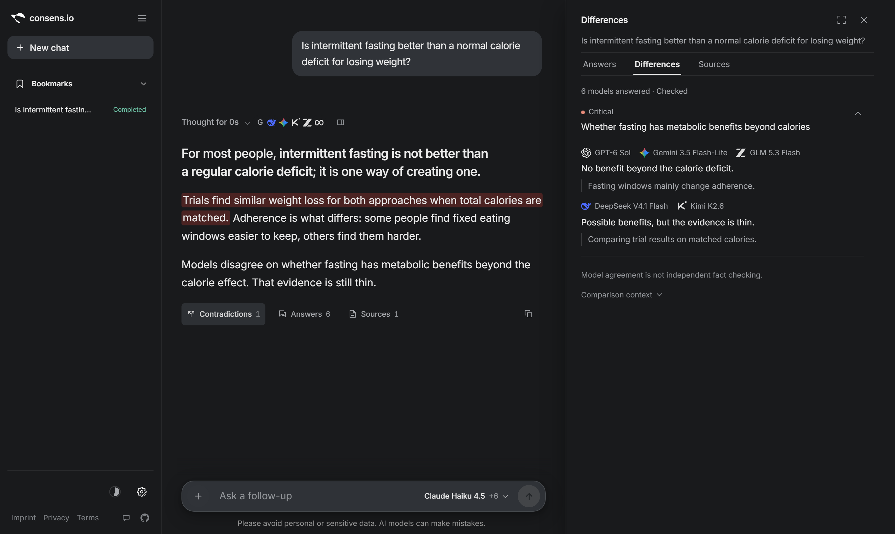

<p align="center">
  <a href="https://consens.io"></a>
</p>

<p align="center">
  <a href="https://consens.io"><strong>consens.io</strong></a> ·
  <a href="https://consens.io/benchmark">Benchmark</a> ·
  <a href="docs/codebase-map.md">Architecture</a> ·
  <a href="docs/README.md">Documentation</a>
  <br><br>
  <a href="https://github.com/sudoleo/consens/actions/workflows/tests.yml"></a>
  
  
</p>

<p align="center">
  
  <br>
  <sub>One agent answer, the disputed claim highlighted, and which models stand on each side. Illustrative demo data, not live model output.</sub>
</p>

**consens.io** lets one AI do the work and has models from other providers
check it: they follow its research, review its answer and mark, sentence by
sentence, what they find wrong, doubtful or incomplete. Side by side, the same
question goes to up to six models from eleven providers, and Watches and the API
run a cross-model consensus. The result is one answer with its doubts written
into it, not a wall of answers.

Agreement between models is a signal, not proof. consens.io treats it as one
input next to source verification, never as a substitute for it.

## What it does

- **Agent mode (default).** An agent researches the web, reads attachments and
  Google sources (read-only), works in its own workspace where the account has
  one, and answers with citations. The models the user picks (one to six)
  follow its work log, can pause a risky step for the user's decision, and
  review the answer; the agent can also ask them for their own view
  (`compare_models`). No judge and no score: a sentence carries a reviewer's
  note, or nobody objected to it.
- **Direct comparison.** Run the same question across models side by side and
  read the answers independently.
- **Consensus.** Anonymised, shuffled answers go to a cross-family judge that
  extracts consensus, disagreements, and an agreement score; a second judge
  checks that every consensus statement is covered.
- **Source checks and Watch.** Claims can be re-verified over time. Watches
  report only evidence-backed changes, not score noise.
- **Share pages and API.** Public snapshots of results, plus a keyed
  [Consensus API v1](docs/consensus-api.md).

## Research

The repository contains the benchmark harness and the frozen sample manifests
behind the published [MMLU-Pro results](https://consens.io/benchmark) (`benchmark/`,
`data/benchmark/`). Method, prompts, and caveats are in
[docs/benchmark-plan.md](docs/benchmark-plan.md). Models, prompts, and
aggregation methods change over time; results are tied to the version that
produced them.

## Architecture

```
app/api        FastAPI routers (ask, consensus, agent, bookmarks, share, admin, ...)
app/core       configuration, auth, assets, rate limits
app/services   LLM clients, judges, agent, usage metering, source verification
static/        classic-script frontend (window.* modules, esbuild bundles)
templates/     Jinja2 pages (app shell, landing, public pages)
benchmark/     MMLU-Pro experiment runner
tests/         pytest, Playwright (E2E), Vitest (frontend), Firestore rules
```

Stack: Python / FastAPI, vanilla JavaScript built with esbuild, Firebase Auth and
Firestore, all LLM traffic through OpenRouter. The full map (routing, core flows,
data model, `window.*` contracts) is [docs/codebase-map.md](docs/codebase-map.md).

## Run locally

Requirements: Python 3.12 (the version in `.python-version`), Node 18+.

```bash
python -m venv venv && source venv/bin/activate   # Windows: venv\Scripts\activate
pip install -r requirements.txt
npm ci && npm run build
cp .env.example .env                              # fill in Firebase + OpenRouter values
MOCK_LLM=1 uvicorn main:app --reload
```

`MOCK_LLM=1` serves canned model output, so no provider calls are billed.
Note that a local server still talks to the Firestore project in your `.env`;
see [docs/testing.md](docs/testing.md) for the safe setup.

## Tests

```powershell
.\dev.ps1 check frontend   # Vitest + build freshness
.\dev.ps1 check backend    # pytest
.\dev.ps1 check browser    # Playwright against the Firebase emulator
.\dev.ps1 check rules      # Firestore security rules
```

CI runs on every push and pull request ([workflow](.github/workflows/tests.yml)).
Details: [docs/testing.md](docs/testing.md), [docs/frontend-build.md](docs/frontend-build.md).

## License

Licensed under the [Apache License 2.0](LICENSE).

## Status

consens.io is an actively developed solo project and is currently free to use
while in testing. Internal design notes and audits in `docs/` are mostly in
German; the index in [docs/README.md](docs/README.md) says which are current.

The product film lives in its own repository,
[sudoleo/consens-video](https://github.com/sudoleo/consens-video).
